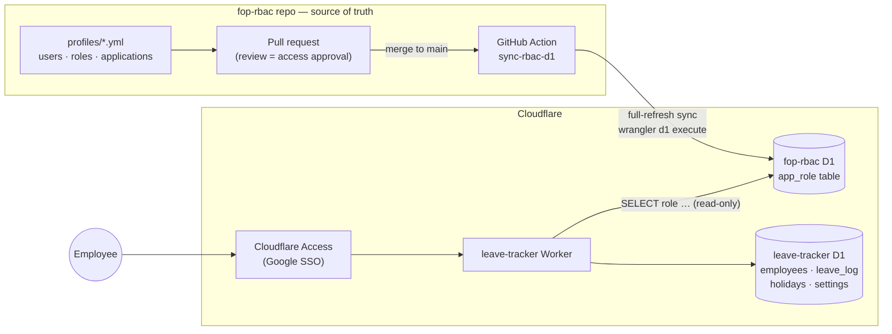
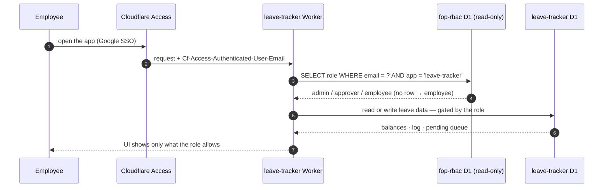
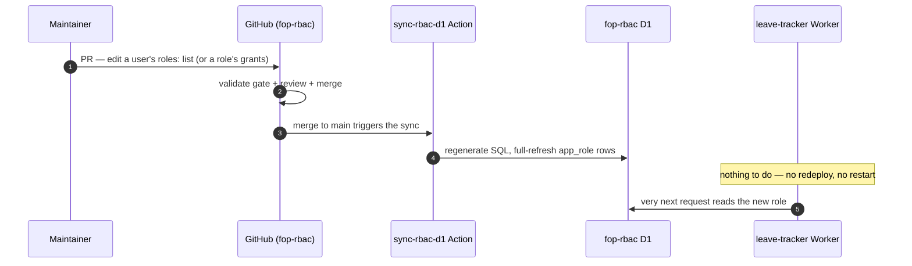
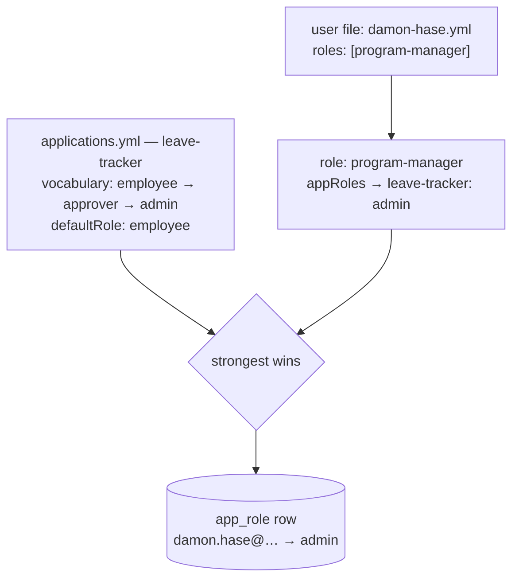

# Leave Tracker × FOP RBAC — how they work together

The Leave Tracker no longer decides who can do what. **FOP RBAC** (this repo)
owns roles; the Leave Tracker reads them at request time from a Cloudflare D1
database that RBAC materializes and keeps in sync. Role changes are YAML PRs
here — the app never redeploys for them.

## The big picture

Two databases, two owners, joined by email at request time:

| Database | Owned by | Holds | Written by |
|---|---|---|---|
| `fop-rbac` D1 | **RBAC** | `app_role` — who is `employee` / `approver` / `admin` per app | fop-rbac CI only |
| `leave-tracker` D1 | **the app** | employees, leave log, holidays, settings — all leave data | the app only |

## What happens on every request

Identity comes from the **verified Access JWT header**, never from anything the
client can set. The role comes from the RBAC D1 — **fail closed**: a missing
row, an unknown role string, or a lookup error all degrade to `employee`
(own data only). One hardcoded break-glass admin survives an RBAC outage.

## What happens when a role changes

Offboarding works the same way: remove the user file (or the role line) and the
sync **deletes** their rows — access is gone on the next request.

## How a person's role is computed

Permissions attach to **roles**, never to individual people. A person's
effective app role = the strongest grant across every role they hold, with the
app's `defaultRole` as the floor for everyone:

So: **assign a role, get its whole bundle** — appointing someone
`program-manager` automatically makes them a leave-tracker `admin`; removing
the line revokes it. The current tiers:

| Tier | May do | Held today by |
|---|---|---|
| `employee` (default) | own balances, own requests | everyone |
| `approver` | + approve/reject, see all logs & balances | *(vacant — ready for future use)* |
| `admin` | + settings, holidays, member management, on-behalf entries | **Norbert** (executive) · **Damon** (program-manager) |

## The contract in one box

- Leave Tracker **reads only** (`SELECT`) from the RBAC D1 — fop-rbac CI is the sole writer.
- **Fail closed** — anything unexpected resolves to `employee`.
- **No role caching** beyond a request — that's what makes revocation instant.
- Leave *data* never moves — RBAC holds roles, nothing else.
- Audit trail = **git history** (who changed what, reviewed by whom) + the
  Actions log (when it materialized). The D1 is a projection; the repo wins.

## Related docs

- [`leave-tracker-integration.md`](leave-tracker-integration.md) — the reference contract + monitoring guide
- [`leave-tracker-claude-prompt.md`](leave-tracker-claude-prompt.md) — paste-ready prompt to implement the app-side changes
- [`APP-RBAC.md`](APP-RBAC.md) — the general application-RBAC consumer contract (KV variant)
